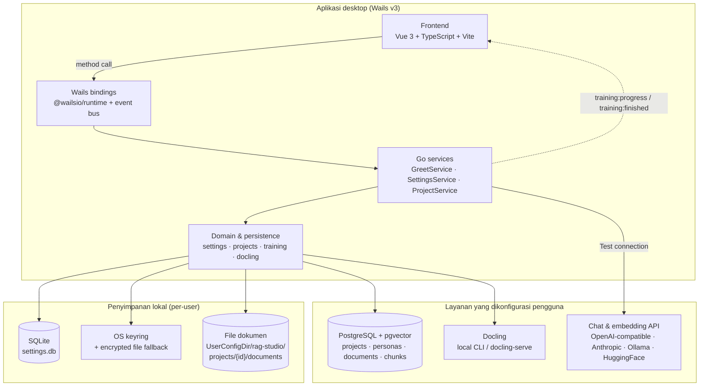
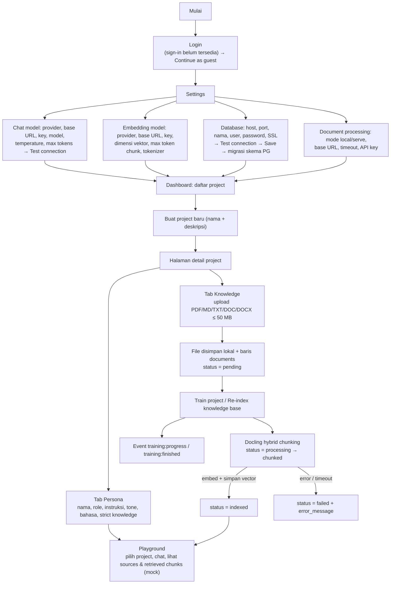
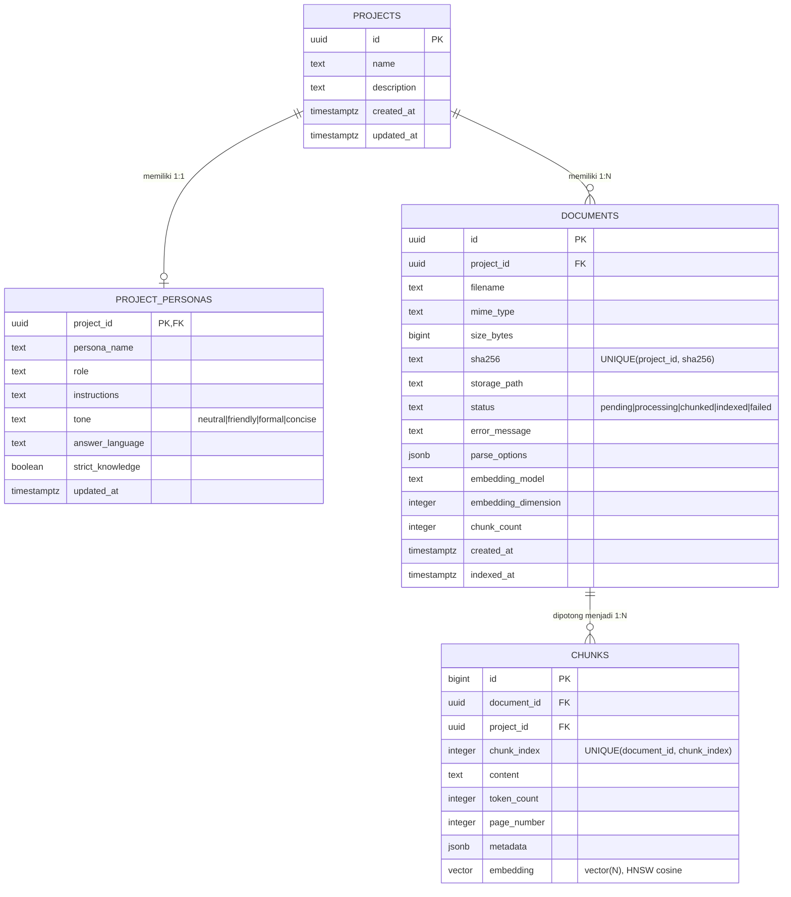
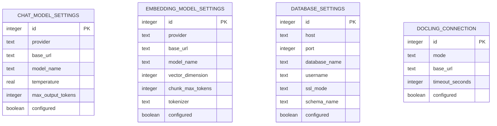

# RAG Studio

RAG Studio adalah aplikasi desktop untuk menyiapkan project RAG. Tiap project punya dokumen dan persona sendiri, jadi knowledge base satu project tidak tercampur dengan project lain. Model chat, model embedding, PostgreSQL, dan Docling diisi lewat halaman Settings.

Saat ini konfigurasi, project, dokumen, chunking, embedding, dan Playground sudah terhubung ke backend. Login dengan akun masih belum tersedia. Rinciannya ada di [Status implementasi](#status-implementasi).

## Daftar isi

- [Tujuan aplikasi](#tujuan-aplikasi)
- [Status implementasi](#status-implementasi)
- [Stack teknologi](#stack-teknologi)
- [Arsitektur](#arsitektur)
- [Alur aplikasi (flowchart)](#alur-aplikasi-flowchart)
- [Model data (ERD)](#model-data-erd)
- [Struktur direktori](#struktur-direktori)
- [Instalasi dan menjalankan](#instalasi-dan-menjalankan)
- [Konfigurasi](#konfigurasi)
- [Keamanan kredensial](#keamanan-kredensial)
- [Pengujian](#pengujian)
- [Roadmap](#roadmap)

## Tujuan aplikasi

Tiap project menyimpan dokumen dan persona sendiri. Persona berisi nama, peran, instruksi (system prompt), nada, bahasa jawaban, dan opsi untuk menjawab hanya dari dokumen yang ada.

Model dan layanan dipilih lewat Settings: chat model, embedding model, PostgreSQL + pgvector, dan Docling. Aplikasi tidak mengikat ke penyedia tertentu.

Playground dipakai untuk mencoba project: pertanyaan dijawab dari dokumen yang sudah di-index dengan memakai persona project.

Konfigurasi lokal ada di SQLite. Kunci API dan password tidak disimpan di sana.

## Status implementasi

| Fitur | Status | Keterangan |
| --- | --- | --- |
| Settings (Chat model, Embedding model, Database, Document processing) | Sudah | Disimpan di SQLite, kunci API dan password di keyring. Tiap bagian punya tombol Test connection. |
| Migrasi skema PostgreSQL | Sudah | Jalan saat Database disimpan. Butuh vector dimension dari Embedding model. |
| Login & akun | Sudah | Register pertama menjadi admin; admin membuat sub-user dan memplot project. Guest bisa mencoba project demo read-only. |
| Project (buat, ubah, hapus, daftar) | Sudah | Tersimpan di tabel `projects`. |
| Persona per project | Sudah | Tersimpan di tabel `project_personas` (1:1). |
| Upload dokumen (PDF, MD, TXT, DOC, DOCX; maks. 50 MB) | Sudah | File disimpan lokal, metadata di tabel `documents`. Dedup memakai SHA-256. |
| Training / chunking via Docling | Sudah | Status `pending → processing → chunked`. Progres lewat event Wails. |
| Embedding dan penyimpanan vektor | Sudah | Setiap chunk di-embed lewat provider yang dikonfigurasi, disimpan ke `chunks.embedding`, lalu dokumen ditandai `indexed`. |
| Playground (chat, sources, retrieved chunks) | Sudah | Chat streaming per token dengan tombol Stop, sources & retrieved chunks nyata, serta panel debug (system prompt, latensi, top-K). |
| Evaluation | Sudah | Set/case evaluasi per project dengan metrik answer/source match. |
| Retrieval tuning | Sebagian | Top-K, min score, hybrid search, rerank, dan guardrails per project. |
| Export/import & backup | Sebagian | Export/import project beserta file dan vektor; backup SQLite. Restore penuh belum ada. |

## Stack teknologi

| Lapisan | Teknologi | Fungsi |
| --- | --- | --- |
| Shell desktop | Wails v3 (`github.com/wailsapp/wails/v3`) | Menjalankan Go dan webview, embed `frontend/dist`, jembatan event. |
| Backend | Go 1.26 | Service, domain, persistensi, pipeline training. |
| Frontend | Vue 3 (`<script setup lang="ts">`), TypeScript, Vite | Antarmuka. |
| Routing | vue-router (hash history) | Navigasi Login → Dashboard → Project → Playground → Settings. |
| Styling | CSS biasa + design token (`tokens.css`, `base.css`) | Tanpa UI kit. |
| Konfigurasi lokal | SQLite (`modernc.org/sqlite`) | `settings.db` di UserConfigDir. |
| Rahasia | OS keyring (`zalando/go-keyring`), fallback file terenkripsi | Kunci API dan password database. |
| Penyimpanan RAG | PostgreSQL + pgvector (`jackc/pgx/v5`) | Project, persona, dokumen, chunk, pencarian vektor HNSW. |
| Parsing dokumen | Docling (`github.com/miku/doclingclient`) | Mode `local` (CLI) atau `serve` (docling-serve), hybrid chunker. |
| Identitas | google/uuid | Primary key UUID. |
| Task runner | Task (`Taskfile.yml`) | Dev, build, package, regenerate bindings. |
| Package manager | npm | Dependency frontend. |

## Arsitektur



`main.go` menyambungkan settings store ke tiga service Wails, lalu membuka window RAG Studio (1024×768). Frontend hanya memanggil service lewat binding. Frontend tidak membuka PostgreSQL atau keyring sendiri.

`ProjectService` membuka koneksi PostgreSQL setiap kali ada operasi, memakai konfigurasi dari `SettingsRepository`, lalu menutupnya. `training.Manager` menjalankan maksimal dua worker per sesi dan mengirim progres lewat event `training:progress` serta `training:finished`.

Nama file dokumen memakai checksum SHA-256, sehingga unggahan yang sama tidak membuat file ganda. Penulisan file dilakukan atomik.

## Alur aplikasi (flowchart)



Saat **Train project** dijalankan:

1. `TrainProject` mengecek konfigurasi database, embedding, dan Docling. Semuanya harus sudah disimpan.
2. Status `processing` dari sesi sebelumnya di-reset (`ResetStaleProcessing`).
3. Dokumen yang perlu dilatih diambil lewat `ListTrainableDocuments`. Kalau semuanya sudah terproses, di-reset untuk re-index.
4. Pipeline menandai `processing`, memanggil Docling `ChunkHybridFile` dengan OCR aktif dan opsi chunk dari Settings → Embedding model, lalu menandai `chunked` beserta jumlah chunk.
5. Kalau gagal, status jadi `failed` dan pesan error disimpan (dipangkas 500 karakter).

## Model data (ERD)

Ada dua database. SQLite menyimpan konfigurasi aplikasi, PostgreSQL menyimpan data RAG.

### PostgreSQL (data RAG)

Skema dibuat oleh `projects.SchemaSQL(vectorDimension)` dengan extension `vector`.



Indeks yang dipakai:

- `idx_documents_project` untuk query dokumen per project.
- `idx_chunks_project` membatasi pencarian ke satu project.
- `idx_chunks_embedding` memakai HNSW dengan `vector_cosine_ops` untuk pencarian vektor.
- `ON DELETE CASCADE` dari `projects → documents → chunks` menghapus turunan saat project dihapus.

Dokumen lama `rag_module_analysis.md` menyebut tabel `schema_migrations`. Tabel itu tidak dibuat oleh skema di `internal/projects/schema.go`.

### SQLite (konfigurasi aplikasi)

Empat tabel berisi satu baris (`id = 1`) dan tidak punya relasi. Kunci API tidak disimpan di sini, hanya status `configured`, `set`, dan `hint`.



## Struktur direktori

```text
.
├── main.go                     # composition root Wails
├── go.mod / go.sum             # dependency Go
├── Taskfile.yml                # dev, build, package, bindings
├── build/                      # aset dan template packaging Wails (linux, windows, darwin, ...)
├── frontend/
│   ├── src/
│   │   ├── pages/              # Login, Dashboard, ProjectDetail, Playground, settings/*
│   │   ├── components/         # komponen UI bersama
│   │   ├── layouts/            # AppShell (sidebar)
│   │   ├── services/           # adapter binding Wails ke UI, dengan fallback data contoh
│   │   ├── mock/data.ts        # data contoh untuk UI yang belum terhubung
│   │   ├── router/             # vue-router
│   │   └── styles/             # tokens.css, base.css
│   ├── bindings/               # TypeScript bindings hasil generate Wails
│   └── dist/                   # hasil build frontend, di-embed oleh Go
└── internal/
    ├── service/                # service yang di-bind ke Wails
    ├── settings/               # model, store SQLite, secret store, probe koneksi
    ├── projects/               # model, store PostgreSQL, skema/migrasi
    ├── training/               # manager worker, pipeline chunking, progress
    └── docling/                # adapter doclingclient → Chunker
```

## Verifikasi rilis

Setiap rilis menyertakan `SHA256SUMS`. Verifikasi:

```bash
sha256sum -c SHA256SUMS --ignore-missing
```

Paket `.deb` ditandatangani dengan kunci rilis RAG Studio. Import kunci publik dari repo (`docs/rag-studio-release.gpg.key`) atau dari aset rilis:

```bash
gpg --import docs/rag-studio-release.gpg.key
gpg --fingerprint 863320B6B89B26B2988B55883D8DC7AC7D242CF0
# Cara 1: tanda tangan dpkg
dpkg-sig --verify rag-studio_*.deb
# Cara 2: tanda tangan detached
gpg --verify rag-studio_*.deb.asc rag-studio_*.deb
```

Fingerprint kunci rilis: **`863320B6B89B26B2988B55883D8DC7AC7D242CF0`**.

Untuk maintainer: workflow membutuhkan GitHub Secrets `GPG_PRIVATE_KEY` (private key ASCII-armored, tanpa passphrase) dan opsional `GPG_KEY_ID`. Installer Windows ditandatangani jika secret `WINDOWS_PFX_BASE64` (sertifikat `.pfx` base64) dan `WINDOWS_PFX_PASSWORD` tersedia. Tanpa keduanya, file tetap dihasilkan tetapi peringatan kepercayaan akan muncul.

## Deployment & download

Installer didistribusikan lewat **GitHub Releases**: `https://github.com/RP-Guruh/rag-studio/releases`.
Aset yang tersedia: `.deb` (Debian/Ubuntu amd64 & arm64), installer `.exe` (Windows), serta arsip `.tar.gz`/`.zip`.

```bash
# Debian/Ubuntu
sudo apt install ./rag-studio_0.1.1_amd64.deb
rag-studio
```

Aplikasi bisa mengecek versi terbaru dan mengunduh aset yang sesuai dengan sistem operasi lewat Settings → Setup & health.

**Fresh user:** klik **Continue as guest** untuk masuk mode demo tanpa setup apa pun. Untuk memakai knowledge base sendiri, klik **Set up RAG Studio** → Setup & health, lalu daftar akun admin pertama.

Pembagian tanggung jawab:

| Komponen | Desktop (local stack) | Server/team |
| --- | --- | --- |
| SQLite, file dokumen, keyring | Otomatis oleh aplikasi | Otomatis di volume `/data` |
| PostgreSQL + pgvector | Docker Compose bawaan (`Settings → Setup & health → Start local stack`) | Docker Compose server |
| Docling | Docker Compose bawaan | Docker Compose server |
| Ollama | **Diinstal user sendiri** dari ollama.com/download | Disiapkan operator (atau pakai API eksternal) |
| API key model | Diisi user di Settings | Environment variable / secret store |

Lihat `deploy/local/docker-compose.yml` dan `deploy/server/docker-compose.yml`. Mode server diaktifkan dengan `RAG_STUDIO_SERVER=1`; rahasia dibaca dari `RAG_STUDIO_*` environment variable.

## Instalasi dan menjalankan

Prasyarat:

- Go 1.26 atau lebih baru
- Node.js dan npm
- Wails v3 CLI (`wails3`)
- Task (`go-task`)
- PostgreSQL dengan extension `pgvector`. `CREATE EXTENSION vector;` dijalankan oleh migrasi.
- Docling: mode `serve` (docling-serve aktif) atau mode `local` (CLI `docling` terpasang)

```bash
# 1. Pasang dependency frontend
cd frontend && npm install && cd ..

# 2. Jalankan mode development
task dev
# alternatif: wails3 dev -config ./build/config.yml -port 9245

# 3. Build dan package
task build
task package

# 4. Regenerate bindings TypeScript setelah service Go diubah
task bindings
```

Sebelum membuat project dan melatih dokumen, isi keempat bagian di Settings. Pipeline menolak jalan kalau ada yang belum disimpan.

## Konfigurasi

| Halaman Settings | Field utama | Catatan |
| --- | --- | --- |
| Chat model | Provider (`openai-compatible`, `anthropic`, `ollama`), base URL, kunci API, nama model, temperature, max output tokens | Test connection mengirim permintaan ke provider. |
| Embedding model | Provider (`openai-compatible`, `ollama`, `huggingface`), base URL, kunci API, nama model, vector dimension, max token chunk, tokenizer | Kalau model atau dimensi diganti, semua project harus di-index ulang. Dimensi dipakai untuk `vector(N)` dan validasi. |
| Database | Host, port, nama database, user, password, SSL mode, schema | Test connection mengecek koneksi dan extension `vector`. Save langsung menjalankan migrasi. |
| Document processing | Mode (`local` / `serve`), base URL, timeout (detik), kunci API | Mode `serve` memakai docling-serve. Mode `local` mengecek CLI. |

Field yang disimpan ditandai `configured = true`. Kalau kunci API atau password dikosongkan saat edit, nilai lama tetap dipakai. Jadi tidak perlu mengetik ulang untuk sekadar test koneksi.

## Keamanan kredensial

`chat_model_api_key`, `embedding_model_api_key`, `database_password`, dan `docling_api_key` disimpan di OS keyring (Windows Credential Manager, macOS Keychain, atau libsecret).

Kalau keyring tidak tersedia, dipakai file terenkripsi di direktori konfigurasi aplikasi.

SQLite hanya menyimpan status `set` dan `hint` (misalnya beberapa karakter terakhir) untuk ditampilkan di UI. Nilai rahasianya tidak ikut.

## Pengujian

```bash
go test ./...
```

Test unit jalan tanpa layanan eksternal. Test live dilewati kecuali environment variable ini diisi: `RAG_TEST_PG_PASSWORD`, `RAG_TEST_OPENAI_BASE_URL`, `RAG_TEST_OPENAI_KEY`, `RAG_TEST_OPENAI_MODEL`, `RAG_TEST_OLLAMA_BASE_URL`, `RAG_TEST_OLLAMA_EMBED_MODEL`, `RAG_TEST_OLLAMA_EMBED_DIM`.

## Roadmap

- [x] Isi `chunks.embedding` setelah Docling selesai memotong dokumen.
- [x] Retrieval HNSW per project (`WHERE project_id = ... ORDER BY embedding <=> $query`).
- [x] Jawaban RAG memakai chat model dan persona (`strict_knowledge`, tone, bahasa).
- [x] Playground memakai retrieval dan chat, bukan data contoh.
- [x] Login dengan akun (admin + sub-user + guest demo).
- [x] Migrasi skema berversi dengan tabel `schema_migrations`.
- [x] Streaming jawaban dan tombol Stop.
- [x] Export/import project dan backup SQLite.
- [x] Health dashboard (Settings → Setup & health).
- [x] Restore penuh dari backup (SQLite + semua project/vektor).
- [x] Lokalisasi UI (English/Indonesia) dan pemeriksaan update GitHub.
- [x] Bobot hybrid/rerank yang bisa diatur per project.
- [x] Metadata Docling (heading, caption, doc item) tampil di panel retrieved chunks.
