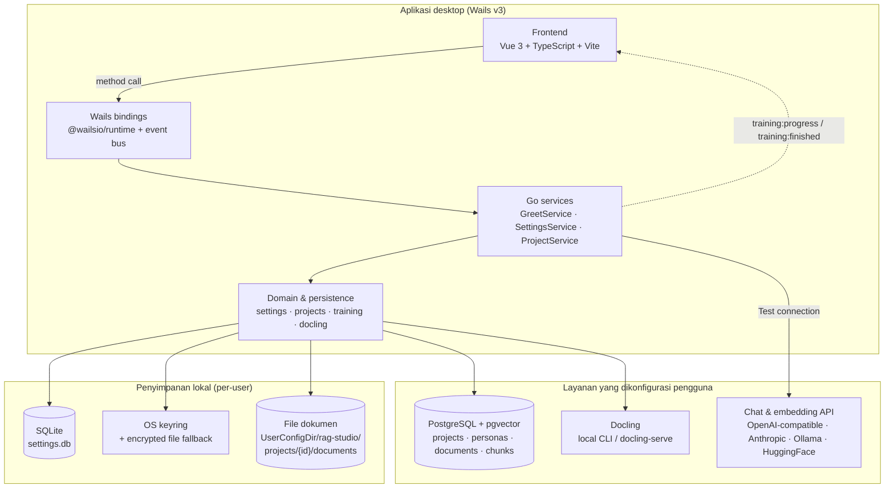
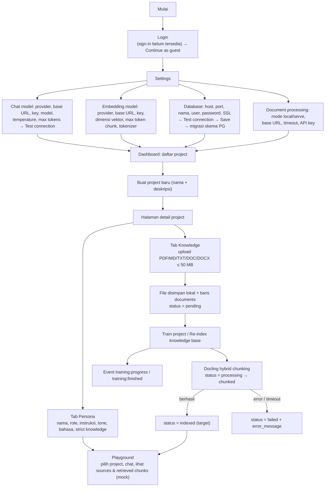
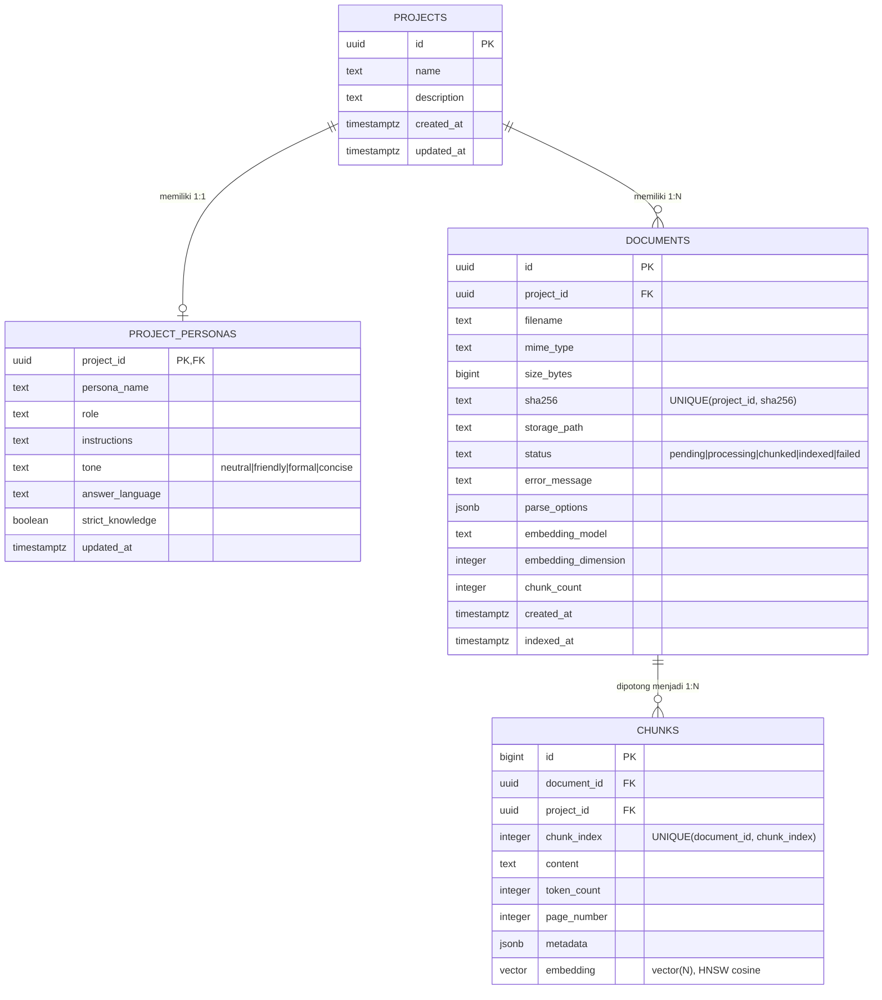
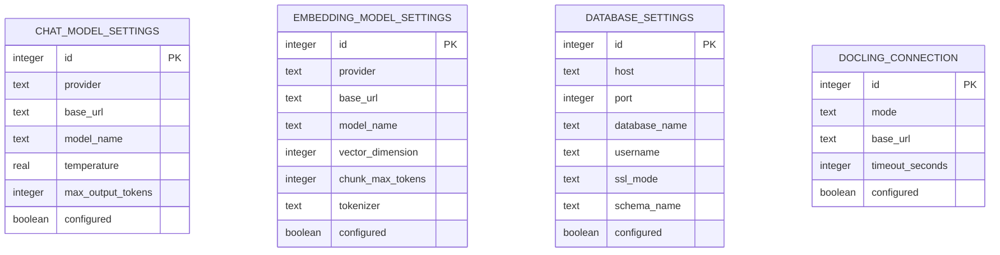

# RAG Studio

Aplikasi **desktop** untuk membuat, mengelola, dan menguji project **RAG (Retrieval-Augmented Generation)**. Setiap project bersifat terisolasi: ia memiliki kumpulan dokumen (knowledge base) dan persona AI sendiri-sendiri. Pengguna membawa sendiri penyedia chat model, embedding model, database PostgreSQL, dan mesin parsing dokumen (Docling) melalui halaman Settings.

> Status saat ini: aplikasi dapat berjalan, konfigurasi tersimpan, project/dokumen tersimpan di PostgreSQL, dan dokumen dapat diproses menjadi chunk melalui Docling. Playground serta tahap embedding/penjawaban masih berupa mock. Lihat [Status implementasi](#status-implementasi).

## Daftar isi

- [Tujuan aplikasi](#tujuan-aplikasi)
- [Status implementasi](#status-implementasi)
- [Stack teknologi](#stack-teknologi)
- [Arsitektur](#arsitektur)
- [Alur aplikasi (flowchart)](#alur-aplikasi-flowchart)
- [Model data (ERD)](#model-data-erd)
- [Struktur direktori](#struktur-direktori)
- [Instalasi dan menjalankan](#instalasi-dan-menjalankan)
- [Konfigurasi](#konfigurasi)
- [Keamanan kredensial](#keamanan-kredensial)
- [Pengujian](#pengujian)
- [Roadmap](#roadmap)

## Tujuan aplikasi

- Memungkinkan pembuatan **beberapa project RAG yang terpisah** dalam satu aplikasi desktop, tanpa saling mencampur data.
- Memisahkan **pengetahuan** (dokumen yang diunggah) dari **perilaku asisten** (persona: nama, peran, instruksi/system prompt, nada, bahasa jawaban, serta opsi "jawab hanya dari knowledge").
- Memberi pengguna kendali penuh atas **model dan infrastruktur** yang dipakai: chat model, embedding model, PostgreSQL + pgvector, dan Docling — bukan terikat pada satu vendor.
- Menyediakan **Playground** untuk mencoba project dan melihat apakah persona serta knowledge base berperilaku sesuai harapan sebelum dipakai lebih lanjut.
- Menyimpan konfigurasi lokal dengan aman (rahasia tidak disimpan sebagai teks biasa di database).

## Status implementasi

| Fitur | Status | Keterangan |
| --- | --- | --- |
| Settings (Chat model, Embedding model, Database, Document processing) | ✅ Terhubung | Disimpan di SQLite; password/API key di OS keyring; tiap kolom punya *Test connection*. |
| Migrasi skema PostgreSQL | ✅ Otomatis | Dijalankan saat Database disimpan; butuh `vectorDimension` dari Embedding model. |
| Login | ⚠️ Mock | Tombol "Continue as guest" berfungsi; sign-in dinonaktifkan. |
| Project (buat, ubah, hapus, daftar) | ✅ Terhubung | Tersimpan di tabel `projects` PostgreSQL. |
| Persona per project | ✅ Terhubung | Tersimpan di tabel `project_personas` (1:1). |
| Upload dokumen (PDF, MD, TXT, DOC, DOCX; maks. 50 MB) | ✅ Terhubung | Byte file disimpan lokal, metadata di tabel `documents`; dedup via SHA-256. |
| Training / chunking via Docling | ✅ Terhubung | Pipeline `pending → processing → chunked`; progres dikirim lewat event Wails. |
| Embedding & penyimpanan vektor | ⚠️ Belum ada | Kolom `chunks.embedding vector(N)` dan indeks HNSW sudah disiapkan, tetapi pipeline belum mengisi embedding. |
| Playground (chat + sources + retrieved chunks) | ⚠️ Mock | Berjalan dari `frontend/src/mock/data.ts`; belum memakai retrieval pgvector maupun chat model. |

## Stack teknologi

| Lapisan | Teknologi | Fungsi |
| --- | --- | --- |
| Shell desktop | **Wails v3** (`github.com/wailsapp/wails/v3`) | Menjalankan Go + webview desktop, embed `frontend/dist`, event bridge. |
| Backend | **Go 1.26** | Service layer, domain, persistensi, pipeline training. |
| Frontend | **Vue 3** (`<script setup lang="ts">`), **TypeScript**, **Vite** | Antarmuka pengguna. |
| Routing | **vue-router** (hash history) | Navigasi Login → Dashboard → Project → Playground → Settings. |
| Styling | CSS vanilla + design tokens (`tokens.css`, `base.css`) | Tidak memakai UI kit. |
| Konfigurasi lokal | **SQLite** (`modernc.org/sqlite`) | `settings.db` di UserConfigDir. |
| Rahasia | **OS Keyring** (`zalando/go-keyring`) + encrypted file fallback | API key dan password database. |
| Penyimpanan RAG | **PostgreSQL + pgvector** (`jackc/pgx/v5`) | Project, persona, dokumen, chunk, pencarian vektor HNSW. |
| Parsing dokumen | **Docling** (`github.com/miku/doclingclient`) | Mode `local` (CLI) atau `serve` (docling-serve) dengan *hybrid chunker*. |
| Identitas | **google/uuid** | Primary key UUID. |
| Task runner | **Task** (`Taskfile.yml`) | Dev, build, package, regenerate bindings. |
| Package manager | **npm** | Dependency frontend. |

## Arsitektur



Poin penting:

- `main.go` adalah *composition root*: membuka settings store, mendaftarkan tiga service ke Wails, lalu membuat window **RAG Studio** (1024×768).
- Service adalah satu-satunya permukaan yang dipanggil frontend; frontend tidak pernah membuka PostgreSQL atau keyring secara langsung.
- `ProjectService` membuka koneksi PostgreSQL **per operasi** menggunakan konfigurasi dari `SettingsRepository`, lalu menutupnya lagi.
- `training.Manager` menjalankan maksimal **2 worker** per sesi aplikasi; progres dikirim sebagai event Wails `training:progress` dan `training:finished`.
- File dokumen disimpan dengan nama = checksum SHA-256 agar unggahan identik tidak duplikat; penulisan dilakukan secara atomik.

## Alur aplikasi (flowchart)



Alur teknis training lebih detail:

1. `TrainProject` memvalidasi konfigurasi database, embedding, dan Docling (semua harus sudah di-Save).
2. Status `processing` yang ditinggalkan sesi sebelumnya di-reset (`ResetStaleProcessing`).
3. Dokumen yang bisa dilatih diambil (`ListTrainableDocuments`); bila semua sudah terproses, di-reset untuk re-index.
4. Pipeline menandai `processing`, memanggil Docling `ChunkHybridFile` dengan OCR aktif dan opsi chunk dari Embedding settings, lalu menandai `chunked` dengan jumlah chunk.
5. Kegagalan dicatat sebagai `failed` disertai pesan error (dipangkas 500 karakter).

## Model data (ERD)

Ada **dua database** dengan peran berbeda: SQLite untuk konfigurasi aplikasi, PostgreSQL untuk data RAG.

### PostgreSQL (data RAG)

Skema dibuat/dimigrasi oleh `projects.SchemaSQL(vectorDimension)` dengan extension `vector`.



Indeks penting:

- `idx_documents_project` — mempercepat query dokumen per project.
- `idx_chunks_project` — membatasi pencarian ke satu project (isolasi multi-tenant).
- `idx_chunks_embedding` — HNSW dengan `vector_cosine_ops` untuk ANN similarity search.
- `ON DELETE CASCADE` dari `projects → documents → chunks` menjaga integritas saat project dihapus.

> Catatan: dokumen lama `rag_module_analysis.md` menyebut tabel `schema_migrations`, tetapi tabel tersebut **tidak** dibuat oleh skema aktif di `internal/projects/schema.go`.

### SQLite (konfigurasi aplikasi)

Empat tabel *single-row* (`id = 1`); tidak ada relasi antar tabel. Nilai rahasia tidak disimpan di sini — hanya flag `configured`, `set`, dan `hint`.



## Struktur direktori

```text
.
├── main.go                     # composition root Wails
├── go.mod / go.sum             # dependency Go
├── Taskfile.yml                # dev, build, package, bindings
├── build/                      # aset & template packaging Wails (linux, windows, darwin, ...)
├── frontend/
│   ├── src/
│   │   ├── pages/              # Login, Dashboard, ProjectDetail, Playground, settings/*
│   │   ├── components/         # komponen UI bersama
│   │   ├── layouts/            # AppShell (sidebar)
│   │   ├── services/           # adapter Wails bindings ↔ UI (+ mock fallback)
│   │   ├── mock/data.ts        # data mock untuk UI yang belum real
│   │   ├── router/             # vue-router
│   │   └── styles/             # tokens.css, base.css
│   ├── bindings/               # TypeScript bindings hasil generate Wails
│   └── dist/                   # hasil build frontend (di-embed oleh Go)
└── internal/
    ├── service/                # service yang di-bind ke Wails
    ├── settings/               # model, store SQLite, secret store, probe koneksi
    ├── projects/               # model, store PostgreSQL, skema/migrasi
    ├── training/               # manager worker, pipeline chunking, progress
    └── docling/                # adapter doclingclient → Chunker
```

## Instalasi dan menjalankan

Prasyarat:

- Go **1.26** atau lebih baru
- Node.js + npm
- Wails v3 CLI (`wails3`)
- Task (`go-task`)
- PostgreSQL dengan extension `pgvector` (`CREATE EXTENSION vector;` — otomatis dijalankan oleh migrasi)
- Docling: mode `serve` (docling-serve berjalan) atau mode `local` (CLI `docling` terpasang)

```bash
# 1. Install dependency frontend
cd frontend && npm install && cd ..

# 2. Jalankan mode development
task dev
# alternatif: wails3 dev -config ./build/config.yml -port 9245

# 3. Build / package aplikasi
task build
task package

# 4. Regenerate bindings TypeScript setelah mengubah service Go
task bindings
```

Saat pertama kali dijalankan, buka **Settings** dan isi keempat bagian (Chat model, Embedding model, Database, Document processing) sebelum membuat project dan melatih dokumen — pipeline menolak berjalan jika salah satu belum di-`Save`.

## Konfigurasi

| Halaman Settings | Field utama | Catatan |
| --- | --- | --- |
| Chat model | Provider (`openai-compatible`, `anthropic`, `ollama`), base URL, API key, nama model, temperature, max output tokens | `Test connection` melakukan round-trip nyata. |
| Embedding model | Provider (`openai-compatible`, `ollama`, `huggingface`), base URL, API key, nama model, **vector dimension**, max token chunk, tokenizer | Mengubah model/dimensi memerlukan **re-index seluruh project**. Dimensi dipakai untuk `vector(N)` dan validasi saat test. |
| Database | Host, port, database, user, password, SSL mode, schema | `Test connection` mengecek koneksi & extension `vector`; `Save` langsung menjalankan migrasi tabel. |
| Document processing | Mode (`local` / `serve`), base URL, timeout (detik), API key | Mode `serve` memakai docling-serve; mode `local` mengecek CLI terpasang. |

Semua field yang tersimpan ditandai `configured = true`. API key/password kosong saat edit akan memakai nilai tersimpan, jadi pengguna tidak perlu mengetik ulang rahasia untuk sekadar test koneksi.

## Keamanan kredensial

- `chat_model_api_key`, `embedding_model_api_key`, `database_password`, dan `docling_api_key` disimpan di **OS keyring** (Windows Credential Manager / macOS Keychain / libsecret).
- Jika keyring tidak tersedia, dipakai **fallback file terenkripsi** di direktori konfigurasi aplikasi.
- SQLite hanya menyimpan status `set` dan `hint` (misalnya beberapa karakter terakhir) untuk keperluan tampilan — bukan nilai rahasia.

## Pengujian

```bash
go test ./...
```

Test unit berjalan tanpa layanan eksternal. Test live yang membutuhkan layanan nyata akan otomatis **di-skip** kecuali environment variable berikut diisi: `RAG_TEST_PG_PASSWORD`, `RAG_TEST_OPENAI_BASE_URL`, `RAG_TEST_OPENAI_KEY`, `RAG_TEST_OPENAI_MODEL`, `RAG_TEST_OLLAMA_BASE_URL`, `RAG_TEST_OLLAMA_EMBED_MODEL`, `RAG_TEST_OLLAMA_EMBED_DIM`.

## Roadmap

- [ ] Implementasi embedding nyata dan penyimpanan vektor ke `chunks.embedding` setelah Docling chunking.
- [ ] Retrieval HNSW per project (`WHERE project_id = ... ORDER BY embedding <=> $query`) pada tabel `chunks`.
- [ ] Generasi jawaban RAG memakai chat model + persona (`strict_knowledge`, tone, bahasa).
- [ ] Mengganti data mock Playground dengan alur retrieval + chat yang sesungguhnya.
- [ ] Autentikasi pengguna (halaman Login saat ini masih mock).
- [ ] Migrasi skema versi terkelola (misalnya tabel `schema_migrations`) alih-alih `ALTER TABLE` inline.
